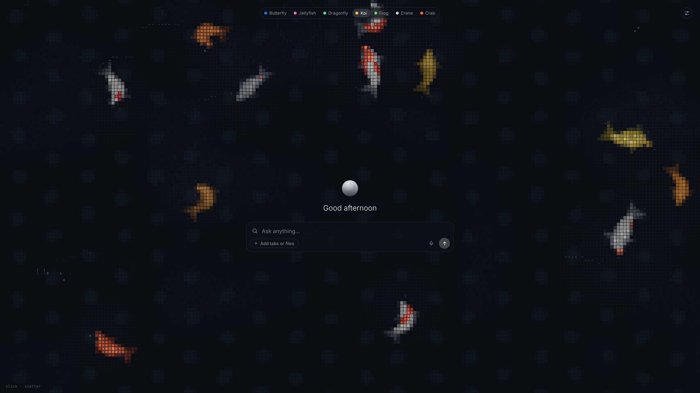

# Glyph Pond

Живая стартовая страница: тёмный фон, населённый существами из символов клавиатуры.
Одна самодостаточная страница на HTML + Canvas 2D — без сборки, без библиотек, без сетевых запросов.


| Koi | Смена вида | Настройки |
| --- | --- | --- |
|  |  |  |

Семь видов существ: Butterfly, Jellyfish, Dragonfly, Koi, Frog, Crane, Crab. Каждое — непрерывный
силуэт, который сэмплируется в сетку квадратных ячеек и затеняется рампой плотности глифов
(`. : - = + * # % @`).

## Запуск

**Обычная страница.** Откройте `index.html` двойным кликом — сервер не нужен.

**GitHub Pages.** В репозитории: Settings → Pages → Deploy from a branch → `main` / `(root)`.
Адрес страницы можно указать в браузере как домашнюю страницу.

**Расширение новой вкладки, Firefox.**

1. Откройте `about:debugging#/runtime/this-firefox`.
2. «Загрузить временное дополнение…» → выберите `manifest.json` в корне репозитория.

Временное дополнение исчезает после перезапуска Firefox. Для постоянной установки дополнение
нужно подписать на addons.mozilla.org (можно без публикации в каталоге) или использовать
Firefox Developer Edition / Nightly с `xpinstall.signatures.required = false`.
В Firefox фокус новой вкладки стоит в адресной строке, поэтому горячие клавиши страницы
начинают работать после клика по ней.

**Расширение новой вкладки, Chromium (Chrome, Brave, Edge).**

1. Откройте `chrome://extensions`, включите «Режим разработчика».
2. «Загрузить распакованное расширение» → выберите папку репозитория.

Манифест один на оба браузера (Manifest V3, `chrome_url_overrides.newtab`,
`browser_specific_settings.gecko.id`).

## Управление

| Действие | Что происходит |
| --- | --- |
| Курсор рядом с существом | Существа в радиусе 140 px мягко отплывают; бабочки и стрекозы машут чаще |
| Клик по фону | Все мягко расходятся от точки клика, всплеск «пыли», на воде — круг; через 2–3 с всё возвращается к норме |
| `1`–`7` или панель сверху | Смена вида: старые существа распадаются на ячейки, из ячеек собираются новые |
| `/` или любой печатный символ | Фокус в поле ввода |
| `Enter` | Поиск: в расширении — поисковая система браузера по умолчанию, на странице — URL-шаблон из настроек; адрес сайта открывается напрямую |
| `Esc` | Снять фокус, закрыть меню |

## Настройки

Кнопка в правом верхнем углу. Всё хранится только локально (`chrome.storage` в расширении,
`localStorage` на странице).

| Настройка | Значения | По умолчанию |
| --- | --- | --- |
| Name | имя для приветствия | пусто |
| Creatures | 25–200% от стартового числа вида | 100% |
| Cell size | 6–14 px | 9 px |
| Glyph density | доля ячеек с символом, 0–100% | 85% |
| Colors | Auto / Natural / Adaptive (см. «Палитра системы») | Auto |
| Palette URL | адрес `palette.json` | `http://127.0.0.1:8765/palette.json` |
| Search URL | шаблон с `%s` (только на обычной странице) | `https://duckduckgo.com/?q=%s` |
| Space effects | среда вокруг существ: ветер, волны, пузырьки, детали фона | вкл. |
| Pause animation | остановить движение | выкл. |
| Show hint | подпись `click · scatter` | вкл. |
| Battery saver | 30 fps и вдвое меньше частиц | выкл. |

Приветствие зависит от времени суток: `Good morning` (5–12), `Good afternoon` (12–18),
`Good evening` (18–23), `Still up?` (ночью).

Параметры адреса действуют на один сеанс: `?creature=koi`, `?cell=9`, `?count=1.2`,
`?color=natural`, `?palette=URL`, `?fps=24`, `?adapt=0` (не снижать качество автоматически),
`?wallpaper=1` (режим обоев).

## Существа

| Вид | Силуэт | Движение | Стартовое число (1080p) |
| --- | --- | --- | --- |
| Butterfly | четыре лопасти крыльев, тёмное тело, усики; размах 3–12 ячеек | взмахи 4–6 Гц, блуждание, зависания | 16 |
| Jellyfish | купол и 4–5 щупалец-цепочек | пульс: рывок вверх и дрейф вниз, щупальца запаздывают | 10 |
| Dragonfly | тонкое тело, четыре узких крыла | зависает с дрожанием, затем резкий бросок | 10 |
| Koi | 10 узлов позвоночника, хвост веером, грудные плавники; узор шумом | волна по телу, S-повороты, лёгкая стайность | 12 |
| Frog | тело, голова с глазами, четыре лапы | сидит, прыгает по параболе, круг из точек при приземлении | 8 |
| Crane | длинные крылья с тёмными кончиками, шея, ноги | парит, редкие взмахи, клин из 3–5 птиц | 7 |
| Crab | панцирь, две клешни, шесть ног | бежит боком рывками, щёлкает клешнями | 9 |

Число существ масштабируется по площади окна. Размер, яркость и скорость связаны: мелкие
существа тусклее и медленнее. У каждой особи свой сдвиг оттенка.

## Среда

У каждого вида своё пространство. Оно состоит из неподвижных деталей, запечённых в фон, и
движущихся эффектов; ветер и течение сносят «пыль» и немного самих существ.

| Вид | Среда | Детали фона | Движение |
| --- | --- | --- | --- |
| Butterfly | луг | трава и цветы символами `' , " * v` | порывы ветра струями `- ~`, волны ветра по траве, пыльца |
| Dragonfly | камыши над водой | стебли и точки | ветер, пыльца, редкие круги на воде |
| Crane | ночное небо | звёзды | облака, длинные струи ветра |
| Koi | пруд сверху | камешки на дне | блики, гребни волн `~~~`, круги, пузырьки `. o O` |
| Frog | пруд с кувшинками | листья кувшинок | блики, волны, круги от прыжков |
| Jellyfish | толща воды сбоку | взвесь | поднимающиеся пузырьки, течения, «морской снег» |
| Crab | берег | песок и камешки | длинные волны прибоя, блики |

Цвет среды — последний материал палитры вида, поэтому в режиме Adaptive он тоже берётся из
палитры системы. Какая среда у вида, задаёт константа `ENV` в файле существа; сами среды описаны
в `js/ambient.js`. При экономии батареи и `prefers-reduced-motion` эффектов становится меньше.

## Структура проекта

```
index.html              страница и разметка интерфейса
manifest.json           расширение новой вкладки (Firefox и Chromium)
css/style.css           интерфейс поверх сцены
js/config.js            общие константы сцены
js/util.js              математика, шум, цвет (HSL, OKLCH)
js/storage.js           chrome.storage / localStorage
js/atlas.js             атлас глифов
js/raster.js            растеризатор: силуэт → ячейки → тайлы и символы
js/particles.js         «пыль» и обломки при смене вида
js/creatures/base.js    общее поведение: курсор, толчки, выход за край
js/creatures/*.js       по файлу на вид; палитра, число и скорости — константами в начале
js/palette.js           режимы цвета и палитра системы
js/ambient.js           среда: ветер, волны, пузырьки, детали фона
js/scene.js             сетка, цикл кадров, смена вида, адаптация качества
js/ui.js                переключатель, приветствие, поиск, настройки, клавиши
js/main.js              точка входа и параметры адреса
tools/palette-server.py сервер палитры для 127.0.0.1
tools/make_icons.py     генератор иконок расширения
noctalia/               шаблон палитры, пример регистрации и сервис systemd
```

Скрипты подключены обычными тегами `<script>`, ES-модулей нет — страница работает с `file://`.

## Как устроен рендер

- Один `<canvas>` на весь экран, цикл на `requestAnimationFrame`, `devicePixelRatio` ограничен 2.
- Существо отдаёт функцию `sample(x, y)`: яркость и материал в точке. Для каждой ячейки сетки
  берётся покрытие по суперсэмплингу 3×3; покрытие и яркость дают альфу и цвет тайла и символ рампы.
- Тонкие детали (ноги, щупальца, усики) рисуются линиями и ложатся в ячейки штрихами `- / | \`.
- Символы заранее отрисованы в атлас и копируются через `drawImage`.
- Сетка вокруг существ проявляется заранее подготовленным спрайтом с радиальным затуханием.
- Смена вида: ячейки старых существ получают случайную задержку и скорость и тают (0,4–0,6 с),
  ячейки новых слетаются на свои места (0,6–0,9 с).

## Производительность и экономия

- Обновление и отрисовка кадра при 1920×1080 занимают 1–3 мс (замер в headless Chromium без GPU).
- Если средний fps ниже 45 в течение 3 секунд, ячейка увеличивается на 1 px, а лимит частиц
  снижается на 30%.
- Скрытая вкладка — анимация остановлена; неактивное окно — 30 fps.
- `prefers-reduced-motion`: вдвое меньше существ, вдвое медленнее, без разлёта по клику.

## Палитра системы (Noctalia / pywal)

Режимы цвета:

- **Natural** — фиксированные цвета видов.
- **Adaptive** — оттенки существ и интерфейса берутся из палитры системы; форма, узор и движение не меняются.
- **Auto** — Adaptive, если палитра доступна, иначе Natural.

Смена палитры перетекает за 0,6 с. Фон остаётся тёмным и при светлой теме: от `surface` берётся
только оттенок.

| Элемент | Роль палитры |
| --- | --- |
| Butterfly | `primary` |
| Jellyfish | `tertiary` |
| Dragonfly | `secondary` |
| Koi | белый — `on_surface`, красный — `primary`, оранжевый и золото — поворот оттенка `primary` на 30° и 60°, пятна — `secondary` и `tertiary` |
| Frog | `secondary` со сдвигом оттенка к зелёному |
| Crane | `on_surface`, кончики крыльев — `on_surface_variant` |
| Crab | `error` или `tertiary` — что ближе к красно-оранжевому |
| Фон и интерфейс | `surface` (затемнённый), текст — `on_surface` |

Страница понимает два формата файла:

- `palette.json` с полями `surface`, `on_surface`, `on_surface_variant`, `primary`, `secondary`,
  `tertiary`, `primary_container`, `error` и необязательным `mode` (`dark` / `light`);
- pywal-совместимый `colors.json` (`special.background`, `special.foreground`, `colors.color0…15`).

### Сервер палитры

Страница в браузере не читает файлы с диска, поэтому палитру отдаёт маленький сервер.
Он слушает только `127.0.0.1` и отвечает только на `/palette.json`.

```bash
python3 tools/palette-server.py --port 8765
```

Файл ищется по порядку: путь из `--file`, `~/.cache/glyph-pond/palette.json`,
`~/.cache/wal/colors.json`. Страница опрашивает сервер раз в 3 секунды условным запросом;
если сервер молчит, она переходит на Natural и спрашивает реже.

Автозапуск — одним из способов:

```bash
cp noctalia/glyph-pond-palette.service ~/.config/systemd/user/
```

```bash
systemctl --user enable --now glyph-pond-palette.service
```

или строкой в `hyprland.conf`:

```
exec-once = python3 ~/src/glyph-pond/tools/palette-server.py
```

В файле сервиса и в строке `exec-once` поправьте путь к репозиторию.

### Шаблон Noctalia

`noctalia/palette.json.template` рендерит `palette.json` из ролей палитры
(`{{colors.<роль>.default.hex}}` — этот синтаксис одинаков в v4 и v5).

```bash
mkdir -p ~/.config/noctalia/templates
```

```bash
cp noctalia/palette.json.template ~/.config/noctalia/templates/glyph-pond-palette.json
```

Регистрация шаблона зависит от версии — оба варианта лежат в `noctalia/templates.example.toml`:

| Версия | Куда добавить | Блок |
| --- | --- | --- |
| Noctalia v5 | основной конфиг Noctalia | `[theme.templates.user.glyph-pond]` |
| Noctalia Shell (legacy, v4) | `~/.config/noctalia/user-templates.toml`, включается в Settings → Color Scheme → Templates → Advanced | `[templates.glyph-pond]` |

Проверить, что шаблон подхвачен:

```bash
noctalia theme --list-templates
```

Синтаксис сверен с документацией Noctalia
([v5: шаблоны](https://docs.noctalia.dev/noctalia/theming/templates/),
[v5: User Templates](https://docs.noctalia.dev/noctalia/theming/app-theming/),
[legacy](https://docs.noctalia.dev/noctalia-shell-legacy/theming/user-templates/)),
но на живой установке Noctalia шаблон не запускался.

Поля `mode` в шаблоне нет намеренно: страница определяет светлую или тёмную тему по светлоте
`surface`. Запасной источник `~/.cache/wal/colors.json` работает, только если такой файл у вас
кто-то пишет (в v5 это делает, например, шаблон сообщества `pywalfox`).

## Режим обоев

Страница готова к показу как обои: `index.html?wallpaper=1&creature=koi` — без интерфейса и
курсорных эффектов, фон непрозрачный, 30 fps (или `&fps=24`).

Для окна-хоста есть интерфейс `window.GlyphPond`:

- `setPalette(obj)` — передать палитру, прочитанную с диска (`null` — вернуть Natural);
- `pause(true | false)` — остановить анимацию, когда рабочий стол закрыт полноэкранным окном;
- `setSpecies(id)`, `stats()`.

Само окно на слое обоев для Hyprland (layer-shell + WebKitGTK или запись видео для mpvpaper)
в этом репозитории не сделано: это второй этап, и его нужно проверять на реальной машине с Hyprland.

## Приватность

Аналитики и внешних запросов нет. Единственный сетевой запрос — к серверу палитры на
`127.0.0.1`, и только в режимах Auto и Adaptive. В режиме Natural сеть не используется вовсе.

## Что проверено

- Headless Chromium: все семь видов, смена вида, клавиатура, курсор и клик, настройки и их
  сохранение, поиск, палитра через сервер, режим обоев, `prefers-reduced-motion`, пауза в скрытой
  вкладке, автоснижение качества.
- Расширение загружено в Chromium: новая вкладка, `chrome.storage`, `chrome.search`.
- В Firefox расширение не запускалось; манифест написан по документации MDN.

## Лицензия

MIT — см. [LICENSE](LICENSE).
