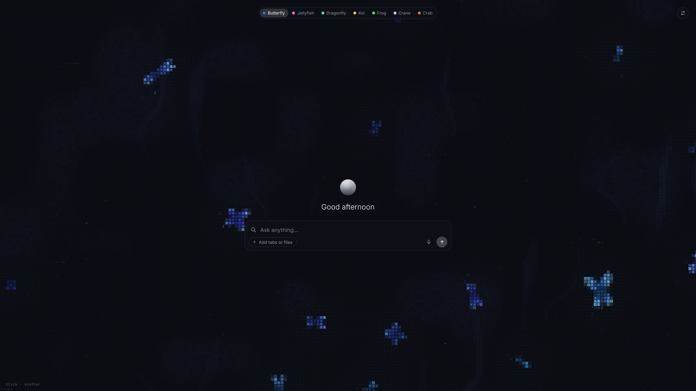
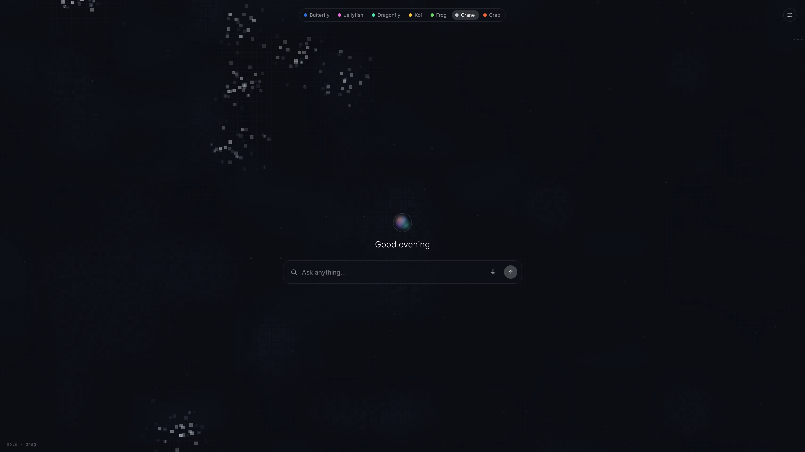
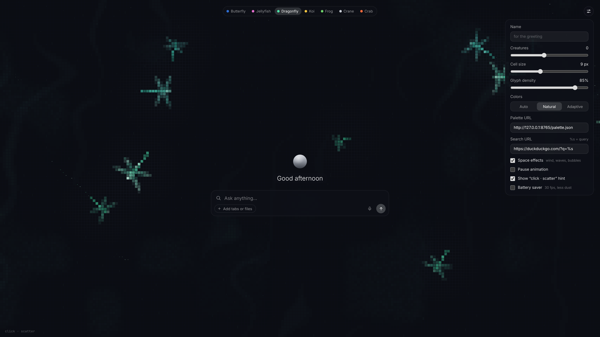

# Glyph Pond

Живая стартовая страница: тёмный фон, населённый существами из символов клавиатуры.
Одна самодостаточная страница на HTML + Canvas 2D — без сборки, без библиотек, без сетевых запросов.



| Koi | Смена вида | Настройки |
| --- | --- | --- |
|  |  |  |

Двенадцать видов существ: Butterfly, Jellyfish, Dragonfly, Koi, Frog, Crane, Crab, Turtle, Ladybug, Starfish, Spider, Snake. Каждое — непрерывный
силуэт, который сэмплируется в сетку квадратных ячеек и затеняется рампой плотности глифов
(`. : - = + * # % @`).

## Запуск

**Обычная страница.** Откройте `index.html` двойным кликом — сервер не нужен.

**GitHub Pages.** В репозитории: Settings → Pages → Deploy from a branch → `main` / `(root)`.
Адрес страницы можно указать в браузере как домашнюю страницу.

**Расширение новой вкладки, Firefox.**

1. Откройте `about:debugging#/runtime/this-firefox`.
2. «Загрузить временное дополнение…» → выберите `manifest.json` в корне репозитория.

Временное дополнение исчезает после перезапуска Firefox. Для постоянной установки дополнение
нужно подписать на addons.mozilla.org (можно без публикации в каталоге) или использовать
Firefox Developer Edition / Nightly с `xpinstall.signatures.required = false`.
В Firefox фокус новой вкладки стоит в адресной строке, поэтому горячие клавиши страницы
начинают работать после клика по ней.

**Расширение новой вкладки, Chromium (Chrome, Brave, Edge).**

1. Откройте `chrome://extensions`, включите «Режим разработчика».
2. «Загрузить распакованное расширение» → выберите папку репозитория.

Манифест один на оба браузера (Manifest V3, `chrome_url_overrides.newtab`,
`browser_specific_settings.gecko.id`).

## Управление

| Действие | Что происходит |
| --- | --- |
| Курсор рядом с существом | Существа в радиусе 140 px мягко отплывают; бабочки и стрекозы машут чаще |
| Зажать существо и вести | Существо берётся за то место, за которое схватили: рыбу можно держать за голову, середину или хвост, бабочку — за крыло. Тело висит на руке, отстаёт по инерции и разворачивается вслед за движением |
| Отпустить | Существо летит дальше со скоростью руки. Если его раскрутили — летит кувыркаясь и какое-то время собой не управляет, потом выравнивается |
| Столкновения | Брошенное или взятое в руку существо сталкивается с другими: расталкивает их, передаёт импульс, удар не по центру закручивает. Тяжёлые сбивают лёгких; кои получают удар в ту часть тела, куда попали |
| Нажатие по пустому месту | Круг на воде и щепотка «пыли»; существа не разлетаются |
| Правый верхний угол: наведение, `Tab` или касание | Появляется капсула с выбором вида и настройками; без активности гаснет через пару секунд |
| Выпадающий список видов | Сетка 3×4 с номерами клавиш. Смена вида: старые существа распадаются на ячейки, из ячеек собираются новые |
| `1`–`9`, `0`, `[` `]` | Смена вида без капсулы: цифры выбирают первые десять видов, скобки листают все по кругу |
| `/` или любой печатный символ | Фокус в поле ввода |
| `Enter` | Поиск: в расширении — поисковая система браузера по умолчанию, на странице — URL-шаблон из настроек; адрес сайта открывается напрямую |
| Шар над приветствием или кнопка микрофона | Голосовой ввод (см. ниже) |
| `Esc` | Снять фокус, закрыть меню |

## Интерфейс

Главное окно минимально: в покое на нём только сцена, приветствие и поле поиска. Всё остальное
показывается по намерению, а не висит на экране.

- В правом верхнем углу — едва заметный «язычок» из трёх точек. Он нужен там, где нет наведения
  (телефон), и чтобы можно было найти меню.
- Наведение на угол (верхние 64 px правой части экрана), `Tab` или касание «язычка» открывают
  капсулу: `[● вид ⌄] [настройки]`. Пока открыт список или меню, пока курсор над капсулой или
  на ней стоит фокус клавиатуры, она не гаснет; иначе исчезает через ~2,5 с.
- Двенадцать видов — выпадающий список вместо строки кнопок.
- При самом первом запуске капсула на три секунды показывается, чтобы было видно, где управление;
  дальше экран остаётся чистым.
- Подсказка `hold · drag` показывается один раз и гаснет сама: через 9 секунд или после первого
  хвата (вернуть можно в настройках).
- `Esc` закрывает сначала список видов, потом настройки.

## Голосовой ввод

Шар над приветствием — анимированный: внутри плавают цветные пятна в тонах текущего вида.
Нажатие на шар или на микрофон в поле ввода включает распознавание речи: шар оживает и
откликается на громкость голоса, вместо приветствия появляется `Listening…`, распознанный текст
попадает в поле ввода. Повторное нажатие останавливает запись.

- Используется Web Speech API браузера. Он есть в Chromium (Chrome, Edge) и **в Firefox начиная с 160**
  (распознавание на устройстве). В Firefox 159 и старше API нет — шар и микрофон не показываются;
  если после обновления их всё ещё нет, проверьте в `about:config` настройку
  `media.webspeech.recognition.enable`. В Brave распознавание обычно отключено — страница покажет
  `Voice service is unavailable`.
- В Chromium звук для распознавания браузер отправляет на свой сервер, в Firefox распознавание
  локальное. Страница сама звук никуда не передаёт и включает микрофон только по нажатию.
- На живом микрофоне голос проверен в Firefox 160 на Linux (по сообщению пользователя); в
  автотестах распознавание подменено заглушкой.

## Настройки

Кнопка в правом верхнем углу. Всё хранится только локально (`chrome.storage` в расширении,
`localStorage` на странице).

| Настройка | Значения | По умолчанию |
| --- | --- | --- |
| Name | имя для приветствия | пусто |
| Count | 25–200% от стартового числа вида | 100% |
| Speed | скорость существ и среды, 25–200% | 100% |
| Size | размер существ, 60–160% | 100% |
| Cursor reaction | сила реакции на курсор, 0–200% (0 — не реагируют) | 100% |
| Cell size | 6–14 px | 9 px |
| Glyph density | доля ячеек с символом, 0–100% | 85% |
| Grid | заметность сетки, 0–200% | 100% |
| Dust | количество «пыли» от существ, 0–200% | 100% |
| Ground | насколько видна земля под водой и воздухом, 0–200%: меняет и ширину пятен, и непрозрачность | 100% |
| Space effects | движущиеся эффекты среды (ветер, волны, пузырьки, пыльца), 0–200%: масштабирует и число, и яркость; 0 — выключены, фон и земля остаются | 100% |
| Colors | Auto / Natural / Adaptive (см. «Палитра системы») | Auto |
| Palette URL | адрес `palette.json` | `http://127.0.0.1:8765/palette.json` |
| Search URL | шаблон с `%s` (только на обычной странице) | `https://duckduckgo.com/?q=%s` |
| Voice input | показывать шар и микрофон | вкл. |
| Search right after dictation | искать сразу после распознавания | выкл. |
| Creature color | принудительный цвет существа: цветовое колесо (оттенок и насыщенность), ползунок яркости, поле `#rrggbb` и кнопка «Natural» для сброса. Применяется к выбранному виду; «Use for all creatures» красит все | натуральный |
| Voice language | язык распознавания, например `ru-RU`; пусто — язык браузера | пусто |
| Pause animation | остановить движение | выкл. |
| Show hint | подпись `hold · drag` | вкл. |
| Battery saver | 30 fps, меньше частиц и эффектов | выкл. |
| Reset to defaults | вернуть всё, кроме имени и выбранного вида | — |

Приветствие зависит от времени суток: `Good morning` (5–12), `Good afternoon` (12–18),
`Good evening` (18–23), `Still up?` (ночью).

Параметры адреса действуют на один сеанс: `?creature=koi`, `?cell=9`, `?count=1.2`, `?speed=0.5`,
`?color=natural`, `?palette=URL`, `?fps=24`, `?adapt=0` (не снижать качество автоматически),
`?wallpaper=1` (режим обоев).

## Существа

| Вид | Силуэт | Движение | Стартовое число (1080p) |
| --- | --- | --- | --- |
| Butterfly | четыре лопасти крыльев, тёмное тело, усики; размах 3–12 ячеек | взмахи 4–6 Гц, блуждание, зависания | 16 |
| Jellyfish | купол и 4–5 щупалец-цепочек | пульс: рывок вверх и дрейф вниз, щупальца запаздывают | 10 |
| Dragonfly | тонкое тело, четыре узких крыла | зависает с дрожанием, затем резкий бросок | 10 |
| Koi | 10 узлов позвоночника, хвост веером, грудные плавники; узор шумом | волна по телу, S-повороты, лёгкая стайность | 12 |
| Frog | тело, голова с глазами, четыре лапы | сидит, прыгает по параболе, круг из точек при приземлении | 8 |
| Crane | длинные крылья с тёмными кончиками, шея, ноги | парит, редкие взмахи, клин из 3–5 птиц | 7 |
| Crab | панцирь, две клешни, шесть ног | бежит боком рывками, щёлкает клешнями | 9 |
| Turtle | панцирь из шестиугольных щитков, голова, четыре ласты, хвост | плывёт медленно, гребёт ластами по диагонали | 7 |
| Ladybug | круглый красный купол с чёрным швом и пятнами, чёрная голова, ноги, усики | перебежками; иногда раскрывает надкрылья и перелетает, видны прозрачные крылья | 10 |
| Starfish | диск и пять конических лучей с рядом светлых бугорков | ползёт очень медленно, лучи плавно изгибаются | 7 |
| Spider | брюшко со светлым шевроном, головогрудь с глазами, восемь ломаных ног | перебежками, ноги шагают поочерёдно | 7 |
| Snake | цепочка из 28 узлов (до 50 ячеек длиной), ромбы на спине, голова с «шеей», раздвоенный язык | ползёт S-образными изгибами, замирает и пробует воздух | 4 |

Число существ масштабируется по площади окна. Размер, яркость и скорость связаны: мелкие
существа тусклее и медленнее. У каждой особи свой сдвиг оттенка.

## Среда

Сцена видна сверху. Под существами — среда (вода или воздух), а под ней дно: земля, песок,
трава. Дно не сплошное: оно проглядывает пятнами там, где среда расступается. Поверх дна идут
движущиеся эффекты; ветер и течение клонят траву и водоросли, сносят «пыль» и немного самих
существ.

| Вид | Среда | Что проглядывает снизу | Движение |
| --- | --- | --- | --- |
| Butterfly | воздух над лугом | трава разных оттенков, цветочные поляны, тропинки | травинки ложатся по ветру, порывы `- ~`, пыльца |
| Dragonfly | воздух над берегом пруда | ил, вода, заросли камыша | камыш клонится по ветру, пыльца, круги на воде |
| Crane | воздух высоко над землёй | лоскуты полей, леса, река — сквозь облака | облака, длинные струи ветра |
| Koi | пруд | песок, ил, камни, водоросли | водоросли колышутся в течении, блики, волны `~~~`, круги, пузырьки |
| Frog | заросший пруд | тёмный ил, камни, густые водоросли; листья кувшинок с лотосами на поверхности | водоросли, блики, круги от прыжков |
| Jellyfish | толща воды | далёкое дно: песок, скалы, кораллы, водоросли | пузырьки, течения, «морской снег» |
| Crab | пляж | сухой и мокрый песок, лужи прилива, камни, ракушки, морские звёзды | прибой, блики |
| Turtle | пруд | как у кои | как у кои |
| Ladybug | воздух над лугом | как у бабочки | как у бабочки |
| Starfish | пляж | как у краба: песок, камни, ракушки | прибой, блики |
| Spider | воздух над лугом | как у бабочки | как у бабочки |
| Snake | берег пруда | как у стрекозы: ил, вода, камыш | камыш клонится по ветру |

Цвет среды — последний материал палитры вида, поэтому в режиме Adaptive он берётся из палитры
системы; оттенки дна при этом тянутся к нему. Дно и движущиеся эффекты настраиваются отдельно (ползунки Ground и Space effects). Какая среда у вида, задаёт константа `ENV` в
файле существа; описания сред и дна (`ground`) — в `js/ambient.js`. Настройка «Space effects»
на нуле убирает всё это разом.

## Структура проекта

```
index.html              страница и разметка интерфейса
manifest.json           расширение новой вкладки (Firefox и Chromium)
css/style.css           интерфейс поверх сцены
js/config.js            общие константы сцены
js/util.js              математика, шум, цвет (HSL, OKLCH)
js/storage.js           chrome.storage / localStorage
js/atlas.js             атлас глифов
js/raster.js            растеризатор: силуэт → ячейки → тайлы и символы
js/particles.js         «пыль» и обломки при смене вида
js/creatures/base.js    общее поведение: курсор, толчки, выход за край
js/creatures/chain.js   общая физика цепочки узлов: кои и змея (хват за любую часть, бросок, удары)
js/creatures/*.js       по файлу на вид; палитра, число и скорости — константами в начале
js/palette.js           режимы цвета и палитра системы
js/ambient.js           среда: ветер, волны, пузырьки, детали фона
js/scene.js             сетка, цикл кадров, смена вида, адаптация качества
js/voice.js             голосовой ввод и анимированный шар
js/ui.js                переключатель, приветствие, поиск, настройки, перетаскивание, клавиши
js/main.js              точка входа и параметры адреса
tools/palette-server.py сервер палитры для 127.0.0.1
tools/make_icons.py     генератор иконок расширения
noctalia/               шаблон палитры, пример регистрации и сервис systemd
wallpaper/              окно живых обоев для Hyprland (GTK3 + WebKit2GTK + layer-shell) и сервис systemd
```

Скрипты подключены обычными тегами `<script>`, ES-модулей нет — страница работает с `file://`.

## Как устроен рендер

- Один `<canvas>` на весь экран, цикл на `requestAnimationFrame`, `devicePixelRatio` ограничен 2.
- Существо отдаёт функцию `sample(x, y)`: яркость и материал в точке. Для каждой ячейки сетки
  берётся покрытие по суперсэмплингу 3×3; покрытие и яркость дают альфу и цвет тайла и символ рампы.
- Тонкие детали (ноги, щупальца, усики) рисуются линиями и ложатся в ячейки штрихами `- / | \`.
- Символы заранее отрисованы в атлас и копируются через `drawImage`.
- Сетка вокруг существ проявляется заранее подготовленным спрайтом с радиальным затуханием.
- Смена вида: ячейки старых существ получают случайную задержку и скорость и тают (0,4–0,6 с),
  ячейки новых слетаются на свои места (0,6–0,9 с).

## Производительность и экономия

- Обновление и отрисовка кадра при 1920×1080 занимают 1–3 мс (замер в headless Chromium без GPU).
- Если средний fps ниже 45 в течение 3 секунд, ячейка увеличивается на 1 px, а лимит частиц
  снижается на 30%.
- Скрытая вкладка — анимация остановлена; неактивное окно — 30 fps.
- `prefers-reduced-motion`: вдвое меньше существ, вдвое медленнее, меньше эффектов среды.

## Принудительный цвет существа

В настройках, раздел Colors → Creature color: круг цветов (угол — оттенок, расстояние от центра —
насыщенность), ползунок яркости и поле `#rrggbb` (принимает и короткую запись `f00`).
Цвет применяется к выбранному виду (или ко всем, если включено «Use for all creatures») и
сохраняется. «Natural» возвращает натуральные цвета.

Светлота рампы вида сохраняется, меняются оттенок и насыщенность, поэтому тени и блики остаются.
Нейтральные части — белый, чёрные пятна божьей коровки — не перекрашиваются, а среда вида
(фон, блики, пузырьки) остаётся как есть. Особи при этом почти не расходятся по оттенку.
Принудительный цвет важнее режимов Natural и Adaptive.

## Палитра системы (Noctalia / pywal)

Режимы цвета:

- **Natural** — фиксированные цвета видов.
- **Adaptive** — оттенки существ и интерфейса берутся из палитры системы; форма, узор и движение не меняются.
- **Auto** — Adaptive, если палитра доступна, иначе Natural.

Смена палитры перетекает за 0,6 с. Фон остаётся тёмным и при светлой теме: от `surface` берётся
только оттенок.

| Элемент | Роль палитры |
| --- | --- |
| Butterfly | `primary` |
| Jellyfish | `tertiary` |
| Dragonfly | `secondary` |
| Koi | белый — `on_surface`, красный — `primary`, оранжевый и золото — поворот оттенка `primary` на 30° и 60°, пятна — `secondary` и `tertiary` |
| Frog | `secondary` со сдвигом оттенка к зелёному |
| Crane | `on_surface`, кончики крыльев — `on_surface_variant` |
| Crab | `error` или `tertiary` — что ближе к красно-оранжевому |
| Фон и интерфейс | `surface` (затемнённый), текст — `on_surface` |

Страница понимает два формата файла:

- `palette.json` с полями `surface`, `on_surface`, `on_surface_variant`, `primary`, `secondary`,
  `tertiary`, `primary_container`, `error` и необязательным `mode` (`dark` / `light`);
- pywal-совместимый `colors.json` (`special.background`, `special.foreground`, `colors.color0…15`).

### Сервер палитры

Страница в браузере не читает файлы с диска, поэтому палитру отдаёт маленький сервер.
Он слушает только `127.0.0.1` и отвечает только на `/palette.json`.

```bash
python3 tools/palette-server.py --port 8765
```

Файл ищется по порядку: путь из `--file`, `~/.cache/glyph-pond/palette.json`,
`~/.cache/wal/colors.json`. Страница опрашивает сервер раз в 3 секунды условным запросом;
если сервер молчит, она переходит на Natural и спрашивает реже.

Автозапуск — одним из способов:

```bash
cp noctalia/glyph-pond-palette.service ~/.config/systemd/user/
```

```bash
systemctl --user enable --now glyph-pond-palette.service
```

или строкой в `hyprland.conf`:

```
exec-once = python3 ~/src/glyph-pond/tools/palette-server.py
```

В файле сервиса и в строке `exec-once` поправьте путь к репозиторию.

### Шаблон Noctalia

`noctalia/palette.json.template` рендерит `palette.json` из ролей палитры
(`{{colors.<роль>.default.hex}}` — этот синтаксис одинаков в v4 и v5).

```bash
mkdir -p ~/.config/noctalia/templates
```

```bash
cp noctalia/palette.json.template ~/.config/noctalia/templates/glyph-pond-palette.json
```

Регистрация шаблона зависит от версии — оба варианта лежат в `noctalia/templates.example.toml`:

| Версия | Куда добавить | Блок |
| --- | --- | --- |
| Noctalia v5 | основной конфиг Noctalia | `[theme.templates.user.glyph-pond]` |
| Noctalia Shell (legacy, v4) | `~/.config/noctalia/user-templates.toml`, включается в Settings → Color Scheme → Templates → Advanced | `[templates.glyph-pond]` |

Проверить, что шаблон подхвачен:

```bash
noctalia theme --list-templates
```

Синтаксис сверен с документацией Noctalia
([v5: шаблоны](https://docs.noctalia.dev/noctalia/theming/templates/),
[v5: User Templates](https://docs.noctalia.dev/noctalia/theming/app-theming/),
[legacy](https://docs.noctalia.dev/noctalia-shell-legacy/theming/user-templates/)),
но на живой установке Noctalia шаблон не запускался.

Поля `mode` в шаблоне нет намеренно: страница определяет светлую или тёмную тему по светлоте
`surface`. Запасной источник `~/.cache/wal/colors.json` работает, только если такой файл у вас
кто-то пишет (в v5 это делает, например, шаблон сообщества `pywalfox`).

## Живые обои для Hyprland

Страницу можно показывать как обои рабочего стола. Для этого есть окно-хост
`wallpaper/glyph-wallpaper.py`: GTK3 + WebKit2GTK на слое `BACKGROUND` (протокол wlr-layer-shell)
на каждом мониторе. Выбор способа: хост рисует ту же страницу, что и в браузере, поэтому
существа живые, а цвета можно менять на лету; запись видео для `mpvpaper` дала бы повторяющийся
ролик без живой палитры.

Хост делает три вещи:

- **Палитра с диска.** Читает `~/.cache/glyph-pond/palette.json` (шаблон Noctalia) или pywal-совместимый
  `~/.cache/wal/colors.json`, следит за файлом и подставляет палитру в страницу через
  `GlyphPond.setPalette(...)`. Сервер палитры не нужен. Понимает и атомарную замену файла
  (так пишет Noctalia), недописанный JSON игнорирует.
- **Автопауза.** Слушает события Hyprland (сокет `.socket2.sock`) и ставит анимацию на паузу, когда
  на всех мониторах активное рабочее место закрыто полноэкранным окном; снимает паузу, когда оно закрыто.
- **Экономия.** Лимит 30 fps (`--fps`), аппаратное ускорение WebKit включено.

### Установка и запуск (Arch / CachyOS)

```bash
sudo pacman -S python-gobject gtk3 gtk-layer-shell webkit2gtk-4.1
```

```bash
python3 wallpaper/glyph-wallpaper.py --creature koi
```

Автозапуск — строкой в `hyprland.conf` (путь поправьте):

```
exec-once = python3 ~/src/glyph-pond/wallpaper/glyph-wallpaper.py --creature koi
```

Вместо этого можно использовать пользовательский сервис: `wallpaper/glyph-wallpaper.service`
(там же описано, какие переменные окружения ему нужны).

Полезные параметры:

| Параметр | Что делает |
| --- | --- |
| `--creature koi` | вид существ (любой из двенадцати) |
| `--url URL` | показывать страницу по адресу, например с GitHub Pages, вместо локального `index.html` |
| `--fps 24` | ограничение кадров (по умолчанию 30) |
| `--set speed=0.6` | параметр страницы; повторяется: `count=1.4`, `cell=10`, `size=1.2`, `ground=1.5`… |
| `--palette FILE` | файл палитры (можно несколько); по умолчанию два пути выше |
| `--no-palette` | не читать палитру системы, натуральные цвета |
| `--no-pause` | не ставить на паузу под полноэкранными окнами |
| `--window` | обычное окно вместо слоя обоев (отладка) |
| `-v` | печатать сообщения консоли страницы |

### Noctalia

Noctalia строит палитру от обоев рабочего стола, которые выбраны в нём. Живые обои рисуются
поверх, поэтому оставьте в Noctalia любое статичное изображение: оно по-прежнему задаёт палитру, а
хост подхватывает её из файла. Шаблон `palette.json` — в разделе про палитру системы выше.

### Что проверено и что нет

Проверено в контейнере без Wayland (Ubuntu, GTK 3.24, WebKit2GTK 4.1 2.52, Xvfb): страница
открывается в режиме обоев без интерфейса, держится лимит 30 fps, палитра подхватывается при
старте, меняется на лету (в том числе через переименование файла), битый JSON игнорируется,
формат pywal понимается, пауза и возобновление срабатывают на эмуляции событий Hyprland.

**Не проверено на настоящем Hyprland:** сама посадка окна на слой обоев (gtk-layer-shell,
перезапуск с `LD_PRELOAD`, который он требует при запуске из Python), порядок слоёв рядом
с обоями самой Noctalia, работа на нескольких мониторах и разбор реальных ответов `hyprctl`
(использованы поля `monitors[].activeWorkspace.id` и `workspaces[].hasfullscreen`). Если на
вашей версии Hyprland что-то из этого не так, запустите с `-v` и пришлите вывод.

Параметры страницы можно использовать и без хоста: `index.html?wallpaper=1&creature=koi&fps=24`.
Внешний интерфейс страницы — `window.GlyphPond`: `setPalette(obj)`, `pause(on)`, `setSpecies(id)`, `stats()`.

## Приватность

Аналитики и внешних запросов нет. Страница сама обращается только к серверу палитры на
`127.0.0.1`, и только в режимах Auto и Adaptive. Голосовой ввод работает по нажатию и силами
браузера: в Chromium он отправляет звук на сервер распознавания.

## Что проверено

- Headless Chromium: все семь видов, смена вида, клавиатура, курсор, перетаскивание за разные части тела, бросок с закруткой, новые виды, принудительный цвет, скрытое управление (появление и гашение, список видов, `Tab`, касания), настройки и их
  сохранение, сброс, голосовой ввод с заглушкой распознавания, поиск, палитра через сервер, режим обоев, `prefers-reduced-motion`, пауза в скрытой
  вкладке, автоснижение качества.
- Расширение загружено в Chromium: новая вкладка, `chrome.storage`, `chrome.search`.
- Firefox 160 на Linux: расширение и голосовой ввод работают (проверено пользователем вручную; в моей среде Firefox нет, автотестами это не покрыто).

## Лицензия

MIT — см. [LICENSE](LICENSE).
